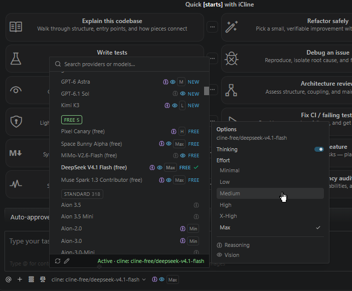
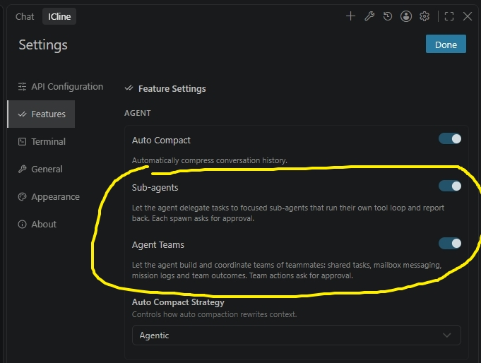

# iCline — Cline Fork

<!-- icline:version -->
> 📦 **Current version:** `0.1.19-dev.5-fix.1` · [Releases](https://github.com/i-mrDedchai/iCline/releases) · [Changelog](https://github.com/i-mrDedchai/iCline/blob/main/apps/vscode/CHANGELOG.md) · [Repo](https://github.com/i-mrDedchai/iCline)
<!-- /icline:version -->

<!-- icline:repo -->
🔗 **GitHub:** [i-mrDedchai/iCline](https://github.com/i-mrDedchai/iCline)
<!-- /icline:repo -->

🌐 **Languages:** English (this page) · [ภาษาไทย](README.th.md)

Standalone Cline fork for VS Code — extension ID **`i-mrdedchai.iCline`**. **No official Cline required.** Supports Grok, ZenMux, OpenRouter, and other providers.

🤖 xAI Grok OAuth & Subscription, ZenMux, safe dual-channel updates, and hardened agent harness.

---

## 🆕 New in 0.1.18

### 🌐 The whole UI reads in your language

Settings (all tabs), welcome home, history, Customize modal, MCP servers, Team panel, Marketplace, Account, onboarding, Browser settings — plus the extension's own notifications and manifest strings — in **English, Thai, Japanese and Simplified Chinese**. Interface language never changes how the agent talks.

### 🎨 Settings → Appearance tab

Accent colors for the Task Completed panel and the final-reply card that follow your editor theme, instead of fixed hex colors.

### ⚡ Quick picker, new design — with per-model Effort

Switch providers and models without leaving the chat, now with a refreshed design and **Thinking / Effort per model** on hover.

### 🏢 Custom providers, managed end to end

Create, edit and delete your own gateways from the **Custom providers** card — with live provider/model stats, **Fetch models automatically** from the endpoint's `/models`, and a Context row that says where its number came from (gateway declaration, your override, catalog majority, or fallback).

### 👥 Sub-agents & Agent Teams

Opt-in multi-agent work under Settings → Agent: `spawn_agent` sub-agents and the full Agent Teams suite (mailbox, mission logs, shared outcomes), a visual **team panel** (topology, per-agent model, mailbox, spawn/shutdown), granular **Team reads / Team writes** approvals, and a **Team budget** (max agents + tokens per turn) so teams can't burn unboundedly.

### 🛡️ Runs that survive trouble

- A stream that dies mid-turn is **retried** instead of ending the run
- A turn cut by the output limit **continues visibly** ("turn truncated, continuing" row) with a bounded thinking budget so recovery turns reach a file write
- Quiet turns announce themselves — retry hints, 10-minute stall warnings, interrupted-turn notices on resume
- Deferred rebuilds (provider / MCP / mode / toggles) wait for the turn instead of killing tasks mid-tool

### 🧬 Selective upstream ports, honestly logged

No wholesale merge: security fast-lane (js-yaml CVE-2026-84375), abort-aware retry backoff, `content-filter` kept distinct from transient failures, compaction on live credentials. Every port *and* skip is recorded in the [Changelog](https://github.com/i-mrDedchai/iCline/blob/main/apps/vscode/CHANGELOG.md), and Settings → About shows the exact upstream sync-point.

---

## ❓ FAQ

### Do I need official Cline installed first?

**No.** iCline is a complete extension on its own. Install from Marketplace or a `.vsix` from [Releases](https://github.com/i-mrDedchai/iCline/releases), open **iCline** in the Activity Bar, then sign in to **xAI · Grok** (or add an API key).

### Can I use iCline and official Cline together?

**Yes, optionally.** They are separate extensions (`i-mrdedchai.iCline` vs `saoudrizwan.claude-dev`) and can run side by side without conflicts. Many users run **only iCline**.

---

## ✨ Why iCline?

| | Cline official (4.1.18 @ 2026-09-16) | iCline (0.1.18 @ 2026-09-30) |
|---|:-:|:-:|
| Extension ID | `saoudrizwan.claude-dev` | `i-mrdedchai.iCline` |
| ⚡ Quick Provider & Model picker on chat | ❌ | ✅ |
| 🏠 Welcome Quick Starts (12 templates, editable prompts) | ❌ | ✅ |
| 📦 History export / import (`.zip`) | ❌ | ✅ |
| 🏷️ iCline branding in agent chat | ❌ | ✅ |
| 🔐 xAI OAuth (SuperGrok / X Premium) | ❌ | ✅ |
| ⚡ Composer 2.5 Fast, Grok Build | ❌ | ✅ |
| 🌐 ZenMux (100+ models) | ❌ | ✅ |
| 🛡️ Harness guardrails (verify-before-claim) | ❌ | ✅ |
| 🔄 Dual-channel updates (iCline + upstream) | ❌ | ✅ |
| 🌐 Full UI in your language (EN / TH / JA / ZH-CN) | ❌ | ✅ |
| 🎨 Appearance tab (theme-accented surfaces) | ❌ | ✅ |
| 🏢 Custom provider management (create / edit / delete, fetch models) | ❌ | ✅ |
| 🏷️ Context row with number source (declared / override / catalog) | ❌ | ✅ |
| 👥 Sub-agents & Agent Teams (panel, budget, granular approvals) | ❌ | ✅ |
| 🛡️ Self-healing runs (mid-stream retry, truncation continuation) | ❌ | ✅ |

### ⚡ Quick Provider & Model picker (chat)

Switch providers and models **without leaving the chat** — search all providers, collapse/expand model lists, set **Thinking / Effort per model** on hover, and refresh dynamic catalogs (see the new-design screenshots in **New in 0.1.18** above).

The full provider catalog and deep model settings remain in **Settings → API Configuration** (stats chips and the Custom providers card included).

---

## 🚀 Getting started

1. Click the **iCline** icon in the Activity Bar (or `Ctrl+Shift+P` → `iCline: Open In New Tab`)
2. Open **Settings** ⚙️ → choose **xAI · Grok (OAuth & Subscription)** or another provider
3. Sign in or add an API key, pick a model such as **Composer 2.5 Fast** or **Grok Build**
4. Describe your task — iCline plans, reads code, edits files, and runs commands (after your approval)

> 💡 **Tip:** If the sidebar shows *Error loading webview* right after install, run **Developer: Reload Window** once and open iCline again (known VS Code on Windows timing issue).

---

## Features

- 🏠 **Welcome home** — 12 quick-start templates with editable prompts; *Autonomous coding agent · in your IDE*
- 📦 **History transfer** — export/import task history as `.zip` archives
- 🏷️ **iCline branding** — agent labels and notifications say iCline during tasks
- 🔐 **xAI · Grok** — OAuth (SuperGrok / X Premium), API key, Grok CLI auth bridge
- ⚡ **Composer 2.5 Fast**, **Grok Build**, subscription model catalog
- 🌐 **ZenMux** — 100+ models, multi-protocol
- 🛡️ Agent harness guardrails (verify-before-claim, post-write verification)
- 🔄 Dual-channel update notifications (iCline + Cline upstream)
- 🌐 **Full UI localization** — every Settings tab, welcome, history, MCP, Team, Account, onboarding in EN / TH / JA / ZH-CN
- 🎨 **Appearance tab** — theme-following accents for the Completed panel and final-reply card
- 🏢 **Custom providers** — create / edit / delete gateways, fetch their models, see where each Context number came from
- 👥 **Sub-agents & Agent Teams** — opt-in multi-agent with team panel, Team reads/writes approvals and Team budget
- 🛡️ **Self-healing runs** — mid-stream retry, visible truncation continuation, quiet-turn and stall notices

## Install & updates

- **VS Marketplace:** [i-mrdedchai.iCline](https://marketplace.visualstudio.com/items?itemName=i-mrdedchai.iCline)
- **Open VSX:** [i-mrdedchai/iCline](https://open-vsx.org/extension/i-mrdedchai/iCline) — Cursor, VSCodium, and other Open VSX IDEs
- **GitHub Releases:** [github.com/i-mrDedchai/iCline/releases](https://github.com/i-mrDedchai/iCline/releases)

## Links

- 📦 [GitHub](https://github.com/i-mrDedchai/iCline)
- 📋 [Changelog](https://github.com/i-mrDedchai/iCline/blob/main/apps/vscode/CHANGELOG.md)
- 🔧 [Build from source](https://github.com/i-mrDedchai/iCline#build-from-source)

## License

Apache-2.0 — derived from [Cline](https://github.com/cline/cline).