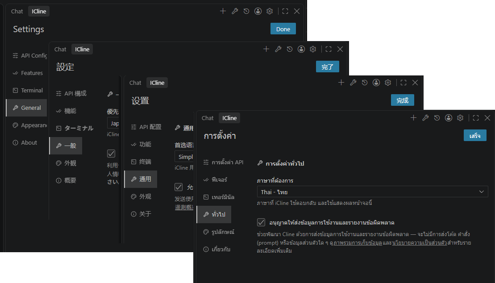
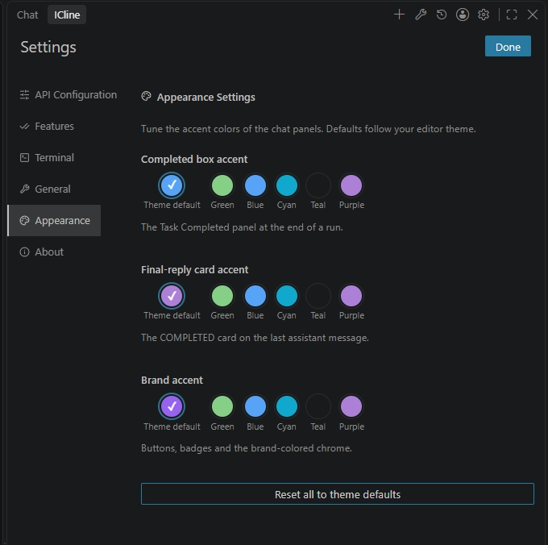
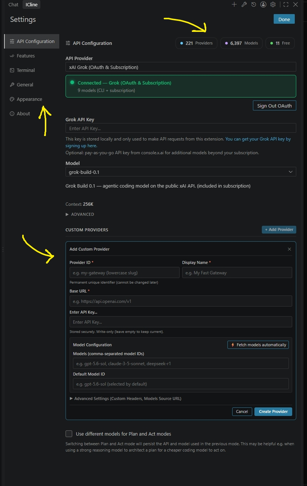

# iCline

<!-- icline:version -->
> 📦 **Current version:** `0.1.19-dev.4` · [Releases](https://github.com/i-mrDedchai/iCline/releases) · [Changelog](https://github.com/i-mrDedchai/iCline/blob/main/apps/vscode/CHANGELOG.md) · [Repo](https://github.com/i-mrDedchai/iCline)
<!-- /icline:version -->

<!-- icline:repo -->
🔗 **GitHub:** [i-mrDedchai/iCline](https://github.com/i-mrDedchai/iCline)
<!-- /icline:repo -->

🌐 **Languages:** English (this page) · [ภาษาไทย](README.th.md)

**iCline** is a **standalone** VS Code extension based on [Cline](https://github.com/cline/cline) (`i-mrdedchai.iCline`). **You do not need official Cline installed** — install iCline, sign in to Grok (or another provider), and start. Optionally, you can also run [official Cline](https://marketplace.visualstudio.com/items?itemName=saoudrizwan.claude-dev) side by side (separate extension IDs, no conflicts).

---

## 🆕 New in 0.1.18

### 🌐 The whole UI reads in your language

All seven Settings tabs, the welcome home and Quick Start cards, the full history view (search, sort/filter, export/import), the Customize modal (Rules / Hooks / Skills), MCP server surfaces, the Team panel, the Marketplace catalog, the Account screens, the Onboarding wizard, Browser settings, plus the extension's own notifications and manifest strings — in **English, Thai, Japanese and Simplified Chinese**. Prompts stay English (they instruct the model), and changing the interface language never changes how the agent talks. See `docs/icline/i18n-contributing.md` to add a language in three edits.

<p align="center">
  
</p>

### 🎨 Settings → Appearance tab

The Task Completed panel gets its own `--color-completed` token (apart from `success`, so tuning it never repaints diff counts or badges) and the transient final-reply card gets `--color-reply`, both following the editor theme. Three accent rows (Completed box, final-reply card, brand chrome) as swatch radiogroups, stored as `iCline.appearance.*` choice ids.

<p align="center">
  
</p>

### ⚡ Quick picker, new design — with per-model Effort

Switch providers and models without leaving the chat, now with a refreshed design and **Thinking / Effort per model** on hover, over live provider/model stats.

<p align="center">
  
</p>

### 🏢 Custom providers, managed end to end

A **Custom providers** card in Settings lists every user-created gateway — create (id slug, display name, base URL, API key, model ids, default model, models-source URL, custom headers), edit in place (API key is write-only), delete behind two-step confirmation. **Fetch models automatically** asks the endpoint's `/models` (Bearer-first, `x-api-key`-only-on-retry) and merges results without duplicating; deleting the active provider falls back safely instead of leaving a mode pointed at nothing (proven in real VS Code). The Context row carries a source badge — gateway declaration, hand-written override, cross-catalog majority, or built-in fallback — so a 444K declaration is visibly distinct from a 1.05M guess.

<p align="center">
  
</p>

### 👥 Sub-agents & Agent Teams

Two opt-in switches under Settings → Agent (both default off): `spawn_agent` sub-agents and the full 18-tool Agent Teams suite (mailbox, mission logs, shared outcomes, persisted team state). A visual **team panel** shows the topology with each agent's own model, the mailbox newest-first, and mouse-driven spawn/shutdown (per-agent model picker). **Team reads / Team writes** approvals split delegated calls by mutability without widening what the lead itself may do; a **Team budget** (max agents + tokens per turn, default 4 teammates) bounds multi-agent spend. Delegated agents inherit the session's real tools — including the terminal — plus its policies and approval callback.

<p align="center">
  
</p>

### 🛡️ Runs that survive trouble

- A stream that dies before its terminal chunk is **retried** instead of ending the run
- A turn cut by the output limit **continues visibly** ("turn truncated, continuing" row, proven end to end in real VS Code), with a bounded thinking budget so recovery turns reach a file write; the default output cap scales as `max(32k, 30% of the model's advertised budget)`
- Quiet turns announce themselves — empty-turn retry hints, 10-minute stall warnings, interrupted-turn notices when resuming history that ended mid-tool
- Deferred rebuilds (provider / MCP / mode / feature toggles) wait for the turn instead of killing tasks mid-tool; toggling Sub-agents / Teams with no active session applies to the next task
- Tool-name repair (`edit` → `editor`…), whitespace-drifted edit retry, and size rejections that always carry the re-send recipe

### 🧬 Selective upstream ports, honestly logged

No wholesale merge: security fast-lane (js-yaml CVE-2026-84375), abort-aware retry backoff, `content-filter` kept distinct from transient failures, compaction summarizer on live credentials. Every port *and* skip is recorded in the [Changelog](https://github.com/i-mrDedchai/iCline/blob/main/apps/vscode/CHANGELOG.md), and Settings → About shows the exact upstream sync-point (`4.1.18 SDK (main@173837314)` / `2026-09-16`).

### 🩺 For power users

- `scripts/diagnose-chat-history.mjs` scans `~/.cline/data/sessions` for turn-cut-mid-run, missing tool results, output-limit truncations, refusals (EN + TH) and parse errors, with `--json`/Markdown reports
- Parallel commands get distinct terminals (proven), detached commands keep their terminal reserved until done

---

## ❓ FAQ

### Do I need official Cline installed first?

**No.** Install iCline from Marketplace or a `.vsix`, open it from the Activity Bar, then sign in to **xAI · Grok** or add an API key.

### Can I use iCline and official Cline together?

**Yes, optionally.** Separate extension IDs — side by side with no conflicts. Many users run **only iCline**.

---

## ✨ Why iCline?

| | Cline official (4.1.18 @ 2026-09-16) | iCline (0.1.18 @ 2026-09-30) |
|---|:-:|:-:|
| Extension ID | `saoudrizwan.claude-dev` | `i-mrdedchai.iCline` |
| Verified publisher | `saoudrizwan` | `i-mrdedchai` ✅ |
| VS Marketplace · Open VSX | Marketplace only | ✅ both |
| ⚡ Quick Provider & Model picker on chat | ❌ | ✅ |
| 🏠 Welcome Quick Starts (12 templates, editable prompts) | ❌ | ✅ |
| 📦 History export / import (`.zip`) | ❌ | ✅ |
| 🏷️ iCline branding in agent chat | ❌ | ✅ |
| 🔐 xAI OAuth (SuperGrok / X Premium) | ❌ | ✅ |
| ⚡ Composer 2.5 Fast, Grok Build | ❌ | ✅ |
| 🌐 ZenMux (100+ models) | ❌ | ✅ |
| 🛡️ Harness guardrails (verify-before-claim) | ❌ | ✅ |
| 🔄 Dual-channel updates (iCline + upstream) | ❌ | ✅ |
| 🌐 Full UI in your language (EN / TH / JA / ZH-CN) | ❌ | ✅ |
| 🎨 Appearance tab (theme-accented surfaces) | ❌ | ✅ |
| 🏢 Custom provider management (create / edit / delete, fetch models) | ❌ | ✅ |
| 🏷️ Context row with number source (declared / override / catalog) | ❌ | ✅ |
| 👥 Sub-agents & Agent Teams (panel, budget, granular approvals) | ❌ | ✅ |
| 🛡️ Self-healing runs (mid-stream retry, truncation continuation) | ❌ | ✅ |

### ⚡ Quick Provider & Model picker (chat)

| | Cline official (4.1.18 @ 2026-09-16) | iCline (0.1.18 @ 2026-09-30) |
|---|:-:|:-:|
| ⚡ Quick Provider & Model picker on chat | ❌ | ✅ |

Switch providers and models **without leaving the chat** — search all providers, collapse/expand model lists, set **Thinking / Effort per model** on hover, and refresh dynamic catalogs.

The full provider catalog and deep model settings remain in **Settings → API Configuration** (stats chips and the Custom providers card included — see the 0.1.18 screenshots in **New in 0.1.18** above).

---

## 🚀 Getting started

1. Open the **Activity Bar** and click the iCline icon (or `Ctrl+Shift+P` → `iCline: Open In New Tab`)
2. Go to **Settings** ⚙️ → choose a Provider
3. Select **xAI · Grok (OAuth & Subscription)** and click **Sign in to xAI Grok** for OAuth  
   Or enter an **API Key** / use auth from **Grok CLI** (`~/.grok/auth.json`)
4. Pick a model such as **Composer 2.5 Fast** or **Grok Build**
5. Describe your task — iCline plans, reads code, edits files, and runs commands (after your approval)

> 💡 **Tip:** Open iCline in the right sidebar to review file changes side-by-side with Explorer.

---

## 📥 Install

- **VS Marketplace:** [i-mrdedchai.iCline](https://marketplace.visualstudio.com/items?itemName=i-mrdedchai.iCline)
- **Open VSX:** [i-mrdedchai/iCline](https://open-vsx.org/extension/i-mrdedchai/iCline) — Cursor, VSCodium, and other Open VSX IDEs
- **GitHub Releases:** [download `.vsix`](https://github.com/i-mrDedchai/iCline/releases)

### Install from VSIX

Download the latest `.vsix` from [GitHub Releases](https://github.com/i-mrDedchai/iCline/releases), then:

```bash
code --install-extension i-mrdedchai.iCline-0.1.19-dev.2-fix.1.vsix --force
```

Or build locally:

```powershell
cd apps/vscode
npm install
npm run package:vsix
code --install-extension dist/i-mrdedchai.iCline-0.1.19-dev.2-fix.1.vsix --force
```

---

## 🤖 Supported xAI models

- ⚡ **Composer 2.5 Fast** — primary coding agent model
- 🔨 **Grok Build** — build / implementation tasks
- 🧠 **Grok 4.3** and other Grok models as xAI enables them

---

## 🎯 Features beyond Cline official

### 🏠 Welcome home & Quick Starts
- Twelve quick-start templates on the welcome screen (always visible, even with 3+ history items)
- Edit, save, reset, and start with custom prompts (⋯ / ✎ popover)
- Subtitle: *Autonomous coding agent · in your IDE*

### 📦 History export / import
- Export selected tasks or all history to a portable `.zip` (manifest + task folders)
- Import archives; duplicate task IDs are reassigned automatically

### 🏷️ iCline branding in chat
- Runtime tool labels, grouped summaries, and approval prompts say **iCline** during tasks

### 🔐 xAI · Grok (OAuth & Subscription)
- Browser sign-in (PKCE OAuth) — SuperGrok / X Premium
- Automatic token refresh
- Reads session from Grok CLI when already logged in
- API key from console.x.ai (pay-as-you-go)

### 🛡️ Agent harness (Fable-style guardrails)
- **Verify-before-claim** — no success claims without verification
- **Post-write verification** — checks files after save
- **Compaction threshold clamp** — limits threshold to 0.5–0.95

### 🔄 Dual-channel updates
- Checks **iCline releases** on GitHub
- Notifies about new **Cline upstream** versions (no auto-merge)
- Command: `iCline: Check for Updates (iCline & Cline upstream)`

### 🌐 Full UI localization
- Every Settings tab, welcome, history, Customize modal, MCP, Team, Marketplace, Account, onboarding — EN / TH / JA / ZH-CN
- Extension notifications and manifest strings (Extensions view, command palette) localized via `vscode.l10n`
- Prompts stay English; interface language never changes how the agent talks

### 🎨 Appearance tab
- Theme-following accents for the Task Completed panel (`--color-completed`) and final-reply card (`--color-reply`)
- Stored as `iCline.appearance.*` choice ids; unknown ids fall back to token defaults

### 🏢 Custom providers
- Create, edit and delete your own gateways from the Custom providers card (write-only API key, two-step delete)
- Fetch models automatically from the endpoint's `/models`; safe fallback when the active provider is deleted
- Context row shows where its number came from: gateway declaration, your override, catalog majority, or fallback

### 👥 Sub-agents & Agent Teams
- Opt-in switches under Settings → Agent (default off); visual team panel with per-agent models, mailbox, spawn/shutdown
- Team reads / Team writes approvals; Team budget (max agents + tokens per turn)
- Delegated agents get the session's real tools (incl. terminal), policies and approval callback

### 🛡️ Self-healing runs
- Mid-stream retry, visible truncation continuation with bounded thinking budget
- Quiet-turn / stall / interrupted-resume notices; rebuilds that wait for the turn

---

## ⚙️ Settings

| Setting | Description | Default |
|---|---|---|
| `iCline.updates.enabled` | Enable update checks | `true` |
| `iCline.updates.releasesUrl` | GitHub Releases API URL | `https://api.github.com/repos/i-mrDedchai/iCline/releases/latest` |
| `iCline.updates.notifyUpstreamCline` | Notify Cline upstream | `true` |
| `iCline.updates.checkIntervalHours` | Check interval (hours) | `24` |

---

## 🌐 ZenMux

**ZenMux** provider supports the full ZenMux feature set:

- 👤 **Account**: Sign in (Email / GitHub / Google) via Settings links
- 🔑 **API Key**: Pay As You Go (`sk-ai-v1-`) and Builder Subscription (`sk-ss-v1-`)
- 📊 **Management API Key**: PAYG balance and subscription quota
- 🔌 **Protocols**: OpenAI Chat, Anthropic Messages, OpenAI Responses, Google Gemini/Vertex
- 📋 **Models**: Auto-fetched from ZenMux (100+ models)

## 🔌 Other providers

Beyond xAI and ZenMux, iCline supports all original Cline providers: Anthropic, OpenAI, OpenRouter, Google Gemini, AWS Bedrock, Azure, LM Studio/Ollama, MCP, and more.

---

## 🔒 Safe updates

- Updating Cline official **will not remove** iCline
- Updating iCline **will not remove** Cline official
- Sync upstream code: `scripts/sync-upstream.ps1`

---

## 📄 Auto-synced docs

On every `npm run package:vsix` or `vscode:prepublish`, `scripts/sync-icline-docs.mjs` syncs README, CHANGELOG, `package.json`, and provider labels.

---

## 📜 License

Apache-2.0 — derived from [Cline](https://github.com/cline/cline)